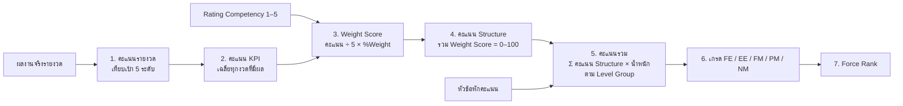
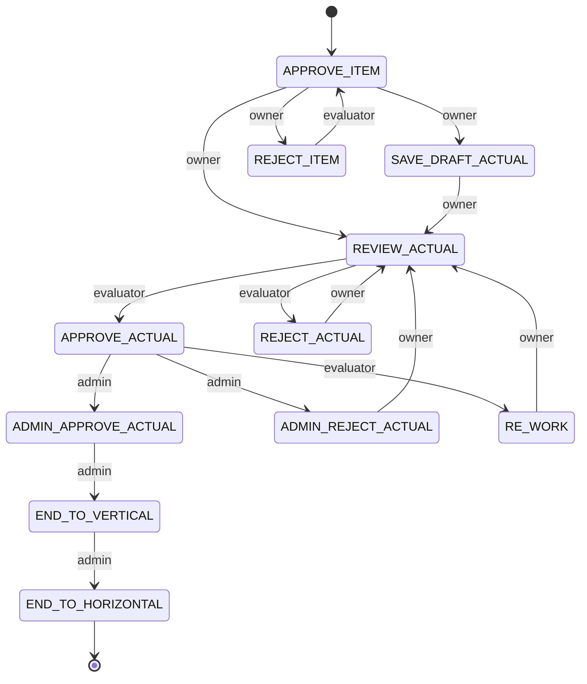

# SEEKPI-2 Scoring Method

| รายการ | รายละเอียด |
|---|---|
| เรื่อง | วิธีคำนวณคะแนน KPI แบบเป้าหมาย 5 ระดับ, Competency, Deduct score, คะแนนรวม, เกรด และ Force Rank |
| ผู้ใช้เอกสาร | HR Performance, C&B, Calibration Committee, ทีมพัฒนาระบบ |
| เวอร์ชัน | 2.1 (5 พฤศจิกายน 2569) เพิ่ม Waive, SUM UP และ ACTION TO ตามระบบเดิม |
| โค้ดที่ใช้คำนวณ | `server/scoring-core.js` (ตัวอย่างทุกข้อตรวจด้วย `server/test/scoring.test.js`) และ Workflow ที่ `server/workflow.js` |
| สถานะ | รอ HR ยืนยันนโยบายในหัวข้อ 11 |

## 1. ภาพรวม

วิธีนี้ยึดตามที่ระบบ SEE KPI เดิมใช้จริง (เห็นได้จากหน้า Assignment และหน้า Appraisal):

- KPI แต่ละข้อมี **ค่าเป้าหมาย 5 ระดับ (คะแนน 1–5) ในทุกงวด** ตามความถี่ของ KPI: Monthly 12 งวด, Quarterly 4 งวด หรือ Yearly 1 งวด
- คะแนนของแต่ละงวด คือระดับสูงสุดที่ผลงานจริงทำได้
- คะแนนรวมแสดงเป็น **สเกล 100 และสเกล 5 คู่กัน** เช่น `71.20 (3.56) / 100.00 (5.00)`
- **น้ำหนักของแต่ละ Structure ขึ้นกับ Level Group** ของพนักงาน (ตั้งค่าที่ Appraisal Criteria)
- **เกรดมี 5 ระดับ**: FE‹S›, EE‹A›, FM‹B›, PM‹C› และ NM‹D›

## 2. ค่าตั้งต้นที่ใช้ในตัวอย่าง

**Structure** (4 Structure ตามระบบเดิม): Company Performance, Project Performance, Individual Performance และ Competency

**Appraisal Criteria: น้ำหนัก Structure ตาม Level Group** (ค่าตัวอย่าง ส่วนค่าจริงต้องดึงจากระบบเดิม)

| Level Group | Company Performance | Project Performance | Individual Performance | Competency |
|---|---|---|---|---|
| Company level (Corporate) | 100 | – | – | – |
| Management (M1–M3) | 20 | 50 | – | 30 |
| Engineer / Professional (P1–P4) | – | 40 | 40 | 20 |
| Supervisor / Foreman (S1–S3) | – | 50 | 50 | – |

**Grade Criteria** (ค่าตัวอย่าง)

| เกรด | ความหมาย | ช่วงคะแนนรวม | ขึ้นเงินเดือน | โบนัส (เดือน) |
|---|---|---|---|---|
| FE‹S› | Far Exceeds Expectation | 90.00 – 100 | 8% | 3.0 |
| EE‹A› | Exceeds Expectation | 75.00 – 89.99 | 6% | 2.0 |
| FM‹B› | Fully Meets Expectation | 55.00 – 74.99 | 4% | 1.5 |
| PM‹C› | Partially Meets Expectation | 40.00 – 54.99 | 2% | 0.5 |
| NM‹D› | Not Meet Expectation | 0 – 39.99 | 0% | 0 |

หมายเหตุ: ถ้าทุก KPI ได้ตามเป้า (ระดับ 3) คะแนนรวมคือ 3 ÷ 5 = **60.00** ช่วงเกรดในตัวอย่างจึงวาง 60 ไว้ใน FM (Fully Meets) ซึ่ง HR ต้องยืนยันช่วงจริงจากระบบเดิม

**Force Rank Group**: FE 10% · EE 20% · FM 50% · PM 15% · NM 5%

## 3. ขั้นที่ 1: คะแนนรายงวดจากเป้าหมาย 5 ระดับ

ในหน้า Assignment ให้กรอกค่าเป้าหมาย L1–L5 ของทุกงวด (กดปุ่ม **ใช้กับทุกงวด / APPLY ALL** เพื่อคัดลอกงวดแรกไปทุกงวด) โดย **L3 คือค่าเป้าหมาย**

| กรณี | วิธีระบบรู้ | กฎ |
|---|---|---|
| ยิ่งมากยิ่งดี | L5 ≥ L1 (ค่าเพิ่มขึ้น) | คะแนน = ระดับ k สูงสุดที่ **ผลจริง ≥ Lk** |
| ยิ่งน้อยยิ่งดี | L5 < L1 (ค่าลดลง) | คะแนน = ระดับ k สูงสุดที่ **ผลจริง ≤ Lk** |
| ผลจริงแย่กว่า L1 | – | คะแนน = **0** |
| ยังไม่มีผลจริง | – | ไม่นับงวดนั้น |

**ตัวอย่าง 1.1: SPI (Monthly, ยิ่งมากยิ่งดี) เป้า L1–L5 = 0.85 / 0.90 / 0.95 / 1.00 / 1.05**

| งวด | Jan | Feb | Mar | Apr | May | Jun | Jul | Aug | Sep | Oct |
|---|---|---|---|---|---|---|---|---|---|---|
| ผลจริง | 0.97 | 1.01 | 0.94 | 0.99 | 1.02 | 1.06 | 0.92 | 0.98 | 1.00 | 1.03 |
| คะแนน | 3 | 4 | 2 | 3 | 4 | 5 | 2 | 3 | 4 | 4 |

เช่น Jan 0.97 ถึง L3 (0.95) แต่ไม่ถึง L4 (1.00) จึงได้ 3 คะแนน ส่วน Sep 1.00 เท่ากับ L4 พอดีจึงได้ 4 คะแนน (ถึงพอดีถือว่าได้)

**ตัวอย่าง 1.2: จำนวนรายการปรับปรุง Audit (Quarterly, ยิ่งน้อยยิ่งดี) เป้า L1–L5 = 4 / 3 / 2 / 1 / 0** (ค่าเดียวกับที่เห็นในหน้าจอระบบเดิม)

| งวด | QTR 1 | QTR 2 | QTR 3 | QTR 4 |
|---|---|---|---|---|
| ผลจริง | 2 | 1 | 0 | 3 |
| คะแนน | 3 | 4 | 5 | 2 |

**ตัวอย่าง 1.3: ผลแย่กว่าระดับ 1** LTIFR เป้า 1.0 / 0.8 / 0.6 / 0.4 / 0.2 แต่ผลจริง 1.2 (มากกว่า L1) จึงได้ **0 คะแนน**

## 4. ขั้นที่ 2: คะแนน KPI

**คะแนน KPI = ค่าเฉลี่ยของคะแนนทุกงวดที่มีผลจริง** (ปัดทศนิยม 2 ตำแหน่ง)

| KPI | คะแนนรายงวด | คะแนน KPI |
|---|---|---|
| SPI (Monthly, Jan–Oct) | 3, 4, 2, 3, 4, 5, 2, 3, 4, 4 | 34 ÷ 10 = **3.40** |
| LTIFR (Quarterly, QTR 1–3) ผล 0.5 / 0.3 / 0.9 เทียบเป้า 1.0 / 0.8 / 0.6 / 0.4 / 0.2 | 3, 4, 1 | 8 ÷ 3 = **2.67** |
| Client satisfaction (Yearly) ผล 4.3 เทียบเป้า 3.6 / 3.8 / 4.0 / 4.2 / 4.4 | 4 | **4.00** |

## 5. ขั้นที่ 3–4: Weight Score และคะแนน Structure

- **Weight Score** ของ KPI = คะแนน KPI ÷ 5 × %Weight (KPI ที่ยังไม่มีผลนับเป็น 0)
- **คะแนน Structure (สเกล 100)** = ผลรวม Weight Score ของทุก KPI ใน Structure (น้ำหนักรวมต้อง 100%)
- **คะแนน Structure (สเกล 5)** = สเกล 100 ÷ 20

**ตัวอย่าง 2: พนักงาน Level Group "Supervisor / Foreman" (Project 50% / Individual 50%)**

Project Performance

| KPI | คะแนน | %Weight | Weight Score |
|---|---|---|---|
| SPI | 3.40 | 40 | 3.40 ÷ 5 × 40 = 27.20 |
| LTIFR | 2.67 | 30 | 2.67 ÷ 5 × 30 = 16.02 |
| Client satisfaction | 4.00 | 30 | 4.00 ÷ 5 × 30 = 24.00 |
| **รวม** | | **100** | **67.22 (3.36)** |

Individual Performance

| KPI | คะแนนรายงวด | คะแนน | %Weight | Weight Score |
|---|---|---|---|---|
| ชั่วโมงอบรม (Yearly) ผล 45 เทียบเป้า 20 / 30 / 40 / 50 / 60 | 3 | 3.00 | 30 | 18.00 |
| Shop drawing ผ่านครั้งแรก % (Quarterly) ผล 82 / 88 / 91 / 76 เทียบเป้า 60 / 70 / 80 / 90 / 95 | 3, 3, 4, 2 | 3.00 | 40 | 24.00 |
| รายการปรับปรุง Audit (ตัวอย่าง 1.2) | 3, 4, 5, 2 | 3.50 | 30 | 21.00 |
| **รวม** | | | **100** | **63.00 (3.15)** |

## 6. ขั้นที่ 5: คะแนนรวม

**คะแนนรวม = Σ (คะแนน Structure สเกล 100 × น้ำหนัก Structure ตาม Level Group) − แต้มหัก**

| Structure | คะแนน | น้ำหนัก | คิดเป็น |
|---|---|---|---|
| Project Performance | 67.22 | 50% | 33.61 |
| Individual Performance | 63.00 | 50% | 31.50 |
| **คะแนนรวม** | | | **65.11 (3.26) / 100.00 (5.00)** ได้เกรด **FM‹B›** |

**ตัวอย่าง 3: Structure ที่ยังไม่มีผล** ถ้า Project Performance ได้ 100 แต่ Individual Performance ยังไม่มีผลเลย คะแนนรวมจะเป็น 100 × 50% + 0 × 50% = **50.00 (2.50)** ซึ่งตรงกับที่ระบบเดิมแสดงในหน้าประเมินระหว่างรอบ

**Competency** ใช้ Rating 1–5 จากผู้ประเมินเป็นคะแนนของแต่ละหัวข้อ แล้วคำนวณ Weight Score และคะแนน Structure ด้วยวิธีเดียวกัน

## 6A. Waive (ยกเว้น KPI)

ในหน้าประเมินของระบบเดิม KPI แต่ละข้อมีสวิตช์ **Waive** ใช้กรณีที่ KPI นั้นวัดไม่ได้ เช่น โครงการถูกยกเลิก หรือย้ายงานกลางปี

- ผู้ประเมิน (Evaluator) หรือ Admin เท่านั้นที่ Waive ได้ ต้องระบุเหตุผลทุกครั้ง และทำไม่ได้หลังสถานะ End to Vertical
- KPI ที่ Waive **ไม่ถูกนำมาคิดคะแนน** และน้ำหนักของ KPI ที่เหลือใน Structure เดียวกันถูก **ปรับรวมกลับเป็น 100%**
- สูตร: คะแนน Structure = Σ Weight Score ของ KPI ที่ไม่ถูก Waive × 100 ÷ Σ %Weight ของ KPI ที่ไม่ถูก Waive

**ตัวอย่าง 2A** (ต่อจากตัวอย่าง 2: Individual Performance) Waive "รายการปรับปรุง Audit" (30%) → (18.00 + 24.00) × 100 ÷ 70 = **60.00 (3.00)** แทน 63.00

## 6B. SUM UP (รวมผลจากผู้ใต้บังคับบัญชา)

ปุ่ม **SUM UP** ในหน้าประเมินดึงผลจริงของ KPI เดียวกันจาก Scorecard ของผู้ใต้บังคับบัญชาในแบบฟอร์มเดียวกัน มาเป็นผลจริงของ Scorecard นี้ทีละงวด

| Scorecard | ผู้ใต้บังคับบัญชาที่นำมารวม |
|---|---|
| รายบุคคล (เช่น ผู้จัดการแผนก) | พนักงานที่มีหัวหน้า (Chief) เป็นเจ้าของ Scorecard นี้ |
| องค์กร (Corporate) | Scorecard รายบุคคลทุกใบในหน่วยงานนั้นและหน่วยงานย่อย |

- KPI ที่ตั้ง **Sum Up** (เช่น จำนวนครั้ง หรือยอดเงิน) ใช้ **ผลรวม** ส่วน KPI อื่น (เช่น %, Index) ใช้ **ค่าเฉลี่ย**
- ไม่นับงวดที่ผู้ใต้บังคับบัญชายังไม่กรอก และไม่นับ KPI ที่ถูก Waive
- ทำได้เฉพาะสถานะที่อนุญาตให้กรอกผล และค่าที่ได้จาก SUM UP แสดงสัญลักษณ์ Σ ในตารางรายงวด

**ตัวอย่าง 2B**: SPI งวด Jan ของลูกทีม 3 คน = 0.97, 1.03, 0.94 → ค่าเฉลี่ย **0.98** · จำนวนรายการปรับปรุง Audit (Sum Up) = 2, 1, 0 และอีกคนยังไม่กรอก → ผลรวม **3**

## 7. Deduct score (กรณีเปิดใช้ Structure ประเภทหักคะแนน)

สูตรเดียวกับหน้าจอ STT03 ของระบบเดิม: ส่วนเกิน = max(0, ผลจริง − `max_value`), แต้มหัก = ส่วนเกิน × `unit_deduct_score` และถ้าผลจริงถึง `value_get_zero` คะแนนรวมเป็น 0 ทันที

**ตัวอย่าง 4:** คะแนนรวม 65.11 · มาสาย 5 ครั้ง (ยอมให้ 3 ครั้ง, หักครั้งละ 0.5) ได้แต้มหัก 1.0 · ขาดงาน 1 วัน (หักวันละ 2, Get Zero = 3) ได้แต้มหัก 2.0 → **62.11** · แต่ถ้าขาดงาน 3 วัน → **0**

หมายเหตุ: Config ปัจจุบันของ Syntec ในระบบเดิมมีเฉพาะ 4 Structure ข้างต้น ไม่ได้ใช้ Structure หักคะแนน แต่ระบบรองรับไว้

## 8. ขั้นที่ 6: เกรด

ปัดคะแนนรวมเป็นทศนิยม 2 ตำแหน่ง แล้วเทียบกับ Grade Criteria เช่น 65.11 ได้ **FM‹B›** ส่วน 89.995 ปัดเป็น 90.00 ได้ **FE‹S›**

เกรดสุดท้ายที่ใช้คำนวณเงิน: เกรดที่ Admin ปรับ → เกรดจาก Force Rank → เกรดจากคะแนน

## 9. ขั้นที่ 7: Force Rank

**9.1 จำนวนคนต่อเกรด (Largest Remainder)**: ปัดลงก่อน แล้วแจกที่นั่งที่เหลือให้เกรดที่มีเศษมากที่สุด (เศษเท่ากัน: ให้เกรดที่ใกล้ FM ก่อน ถ้าห่างเท่ากันให้เกรดที่ต่ำกว่าก่อน)

| จำนวนคนในกลุ่ม | FE | EE | FM | PM | NM |
|---|---|---|---|---|---|
| 16 (โควตา 1.6 / 3.2 / 8.0 / 2.4 / 0.8) | 2 | 3 | 8 | 2 | 1 |
| 10 (โควตา 1.0 / 2.0 / 5.0 / 1.5 / 0.5 เศษ PM กับ NM เท่ากัน PM ใกล้ FM กว่า) | 1 | 2 | 5 | 2 | 0 |
| 7 (โควตา 0.7 / 1.4 / 3.5 / 1.05 / 0.35) | 1 | 1 | 4 | 1 | 0 |

**9.2 จัดอันดับ**: เรียงคะแนนรวม → คะแนน KPI → คะแนน Competency → รหัสพนักงาน แล้วแจกเกรดตามที่นั่ง ถ้าคนที่คะแนนเท่ากันได้คนละเกรด ระบบติดธง **Tie** และกลุ่มที่มีน้อยกว่า 5 คนไม่บังคับ Force Rank

**ตัวอย่าง 5: หน่วยงาน 7 คน**

| อันดับ | พนักงาน | คะแนนรวม | KPI | เกรดจากคะแนน | เกรด Force Rank |
|---|---|---|---|---|---|
| 1 | E101 | 88.40 | 4.20 | EE | **FE** |
| 2 | E102 | 84.00 | 4.00 | EE | **EE** |
| 3 | E103 | 79.20 | 3.90 | EE | **FM** |
| 4 | E104 | 75.60 | 3.90 | EE | **FM** |
| 5 | E105 | 70.10 | 3.60 | FM | **FM** |
| 6 | E107 | 64.50 | 3.60 | FM | **FM** (Tie) |
| 7 | E106 | 64.50 | 3.40 | FM | **PM** (Tie) |

## 10. Workflow ต่อ Structure (ตามระบบเดิม)

แต่ละ Structure ของพนักงานมีสถานะของตัวเอง เช่น Project Performance อาจอยู่ที่ "Review Actual" ขณะที่ Competency ยังเป็น "Appraisal"

- **owner** = พนักงานเจ้าของผลงาน · **evaluator** = หัวหน้า (Chief), ทุกคนใน **ACTION TO** ของ Scorecard นั้น หรือ HR · **admin** = ผู้ดูแลระบบ
- **ACTION TO**: ลำดับผู้ประเมิน (Seq No, พนักงาน, ตำแหน่ง, หน่วยงาน) ของแต่ละ Scorecard HR ตั้งค่าได้ ค่าเริ่มต้นคือหัวหน้าโดยตรง และพนักงานเป็นผู้ประเมินของตัวเองไม่ได้
- กรอกผลจริงได้เฉพาะสถานะ Approve Item, Save Draft Actual, Reject Actual, Admin Reject Actual และ Re-Work
- Competency: Appraisal → Save Draft / Submit (ผู้ประเมิน) → Approve / Reject (admin) → End to Vertical
- ก่อนเปลี่ยนสถานะ น้ำหนัก KPI ใน Structure ต้องรวมได้ 100% (ฐานข้อมูลบังคับด้วย Trigger)

## 11. ประเด็นที่ต้องให้ HR ยืนยัน

| # | ประเด็น | ค่าที่ระบบใช้ตอนนี้ | ทางเลือกอื่น |
|---|---|---|---|
| 1 | ผลแย่กว่าระดับ 1 ได้กี่คะแนน | 0 | 1 |
| 2 | คะแนน KPI จากหลายงวด | ค่าเฉลี่ยของทุกงวดที่มีผล | ใช้งวดล่าสุด หรือรวมผลจริงก่อนแล้วเทียบเป้าของทั้งปี |
| 3 | คะแนนระหว่างระดับ | ขั้นบันได (ได้ระดับที่ถึง) | เทียบสัดส่วนระหว่างระดับ (Interpolation) |
| 4 | ช่วงคะแนนของเกรด FE–NM | 90 / 75 / 55 / 40 | ค่าจริงจาก Grade Criteria ในระบบเดิม |
| 5 | น้ำหนัก Structure ของแต่ละ Level Group | ค่าตัวอย่างในหัวข้อ 2 | ค่าจริงจาก Appraisal Criteria ในระบบเดิม (มี 20 Level Group) |
| 6 | เศษเท่ากันใน Force Rank | ใกล้ FM ก่อน ถ้าห่างเท่ากันให้เกรดต่ำกว่าก่อน | ให้เกรดที่สูงกว่าก่อน |
| 7 | ขนาดกลุ่มขั้นต่ำของ Force Rank | 5 คน | 10 คน หรือรวมกลุ่มเล็กเข้าหน่วยงานแม่ |
| 8 | Force Rank ปรับเกรดขึ้นได้หรือไม่ | ปรับได้ทั้งขึ้นและลง | ปรับลงได้อย่างเดียว |
| 9 | ความหมายของ Value Get Zero (ถ้าเปิดใช้ Deduct) | คะแนนรวมเป็น 0 | เฉพาะ Structure นั้นเป็น 0 |
| 10 | KPI ที่ Waive | ไม่นับ และปรับน้ำหนักที่เหลือเป็น 100% | นับเป็น 0 คะแนน หรือให้คะแนนกลาง (3) |
| 11 | วิธีรวมผลของ SUM UP | ผลรวมสำหรับ KPI ที่ตั้ง Sum Up นอกนั้นเฉลี่ย | ถ่วงน้ำหนักตามขนาดงาน (เช่น มูลค่าโครงการ) |
