# SEEKPI-2 Software Specification

| รายการ | รายละเอียด |
|---|---|
| ระบบ | SEEKPI-2: ระบบบริหาร KPI และประเมินผลการปฏิบัติงาน (Performance Management System) |
| องค์กร | Syntec Construction Public Company Limited |
| เวอร์ชันเอกสาร | 1.3 (5 พฤศจิกายน 2569) เพิ่ม Waive, SUM UP และ ACTION TO |
| สถานะ | Draft for review |
| การตัดสินใจล่าสุด | ติดตั้ง On-premise, ฐานข้อมูล SQLite, ไม่เชื่อมต่อ D365 |
| เอกสารอ้างอิง | `rea-analysis/SPEC.md` (ผล Reverse Engineering ระบบ SEEKPI เดิมด้วย REA), `database/schema.sql`, `docs/SEEKPI-2_Scoring_Method.md`, prototype ใน `seekpi-2/` |

## 1. วัตถุประสงค์และขอบเขต

### 1.1 วัตถุประสงค์
SEEKPI-2 พัฒนาขึ้นเพื่อทดแทนระบบ SEEKPI เดิม (`kpi.syntec.co.th/seekpi`) โดยคงขอบเขตการทำงานเดิมไว้ครบถ้วน ทั้งเมนู สิทธิ์การใช้งาน และหน้าจอรายงาน และปรับปรุงในประเด็นต่อไปนี้

- ปรับโครงสร้างข้อมูลให้รองรับ **Cascading KPI** ตั้งแต่ Corporate ลงไปถึง Division, Department และ Individual
- รองรับการบันทึกผลรายเดือนและ Trend Analysis
- มี **Workflow การอนุมัติที่กำหนดค่าได้** พร้อม Audit Trail ครบทุกขั้นตอน
- นำเข้าข้อมูลพนักงาน โครงสร้างองค์กร และผล KPI จากไฟล์ **Excel/CSV** (ไม่เชื่อมต่อ D365 หรือระบบภายนอกอื่นโดยตรง)
- Login ด้วยบัญชี **Active Directory ของบริษัท (LDAPS)** เหมือนระบบเดิม และมี Local account สำรอง
- ติดตั้ง **On-premise** ใน Data center ของ Syntec ทั้งหมด โดยไม่พึ่ง Cloud service
- สอดคล้องกับ **PDPA** สำหรับข้อมูลเงินเดือนและผลการประเมินรายบุคคล

### 1.2 ขอบเขต (In scope)
| กลุ่มงาน | ฟังก์ชัน |
|---|---|
| Manage User | Role, Users, Permission matrix (View/Add/Edit/Delete/Approve/Export) |
| Setup Data | Company, Organization, Level, Level Group, Position, Position Group, Perspective, KPI Type, UOM, Structure, Competency Score, Appraisal Criteria, Threshold Group, Grade Criteria, Force Rank Group, Form |
| KPI Library | Appraisal Item (KPI / Competency Dictionary) |
| People | Employee, ประวัติการโอนย้าย/เลื่อนตำแหน่ง, Salary history |
| Appraisal | Assignment (Corporate / Organization / Individual), Data Entry รายเดือน, Self/Manager Evaluation, Action Plan, Approval Workflow |
| Calibration | Force Rank ทั้ง 4 แบบ: Company, Vertical (ตามสายงาน), Horizontal (ตามระดับงาน), Horizontal Board |
| Compensation | Import Salary, คำนวณ Merit Increase และ Bonus |
| Dashboard | Branch Performance, Overall Performance, Performance Comparison, Performance Trend |
| Report | รายงาน 9 ฉบับตามระบบเดิม และ Export Excel/PDF |
| Setting | Password Policy, LDAP (Active Directory), E-mail Server, Data Import (Excel/CSV) |
| Feedback | Continuous Feedback / 360, Feedback Report |

### 1.3 นอกขอบเขต (Out of scope, phase 1)
Payroll processing, Learning Management, Mobile native app (phase 1 ใช้ Responsive Web / PWA) และการเชื่อมต่อแบบ Real-time กับ Microsoft Dynamics 365, ระบบ HSE หรือ Cloud service ใด ๆ

### 1.4 คำศัพท์
| คำ | ความหมาย |
|---|---|
| Form | รอบการประเมิน 1 รอบ ซึ่งผูกกับ Period, Criteria, Threshold, Grade และ Force Rank Group |
| Assignment | Scorecard ของพนักงาน 1 คน หรือหน่วยงาน 1 หน่วยงาน ใน Form หนึ่ง |
| Structure | กลุ่มหัวข้อประเมิน ได้แก่ KPI (quantity), Competency (quality) และ Deduct score |
| Threshold | ตารางแปลง % Achievement เป็นคะแนน 1–5 |
| Grade Criteria | ตารางแปลงคะแนนรวม (0–100) เป็นเกรด FE‹S› / EE‹A› / FM‹B› / PM‹C› / NM‹D› พร้อม % ขึ้นเงินเดือนและจำนวนเดือนโบนัส |
| เป้าหมาย 5 ระดับ | ค่าเป้าหมาย L1–L5 (คะแนน 1–5) ของ KPI ในแต่ละงวด (Monthly / Quarterly / Yearly) โดย L3 คือค่าเป้าหมาย |
| Force Rank | การ Calibrate เกรดตามสัดส่วน (Bell curve) ที่กำหนด |

## 2. ผู้ใช้งานและบทบาท

| Actor | หน้าที่หลัก | Data scope |
|---|---|---|
| System Administrator | ตั้งค่าระบบ ผู้ใช้ สิทธิ์ และการนำเข้าข้อมูล | all |
| HR Performance Officer | ตั้งค่า Form/Criteria, มอบหมาย KPI, ติดตามสถานะ, Calibration, ออกรายงาน | company |
| Compensation Officer (C&B) | นำเข้าเงินเดือน, คำนวณและอนุมัติ Bonus/Merit | company (ข้อมูลเงินเดือน) |
| Executive / Calibration Committee | ดู Dashboard, อนุมัติผล Force Rank | company |
| Line Manager (Evaluator) | กำหนด Target, ประเมินผู้ใต้บังคับบัญชา, อนุมัติ Self-evaluation | subordinate |
| Project Manager / Data Owner | บันทึกผล KPI รายเดือนของโครงการ (SPI, CPI, LTIFR, NCR) | organization |
| Employee | ยอมรับ KPI, บันทึกผล, Self-evaluation, Action Plan, Feedback | self |

## 3. Functional Requirements

| ID | Requirement | Priority |
|---|---|---|
| FR-01 | ผู้ใช้ Login ด้วยบัญชี Active Directory (LDAPS bind) ได้ และมี Local account สำรองสำหรับ Admin ซึ่งใช้ Password Policy | Must |
| FR-02 | ระบบแสดงเมนูเฉพาะรายการที่ Role ของผู้ใช้มีสิทธิ์ `can_view` (ตามกติกาเดิมของ SEEKPI) | Must |
| FR-03 | HR สร้าง Form ประจำปี โดยเลือก Period, Appraisal Criteria, Threshold Group, Grade Criteria และ Force Rank Group | Must |
| FR-04 | HR และ Manager สร้าง Assignment ได้ทั้งแบบ Corporate, Organization และ Individual และมอบหมายพร้อมกันหลายคนได้ | Must |
| FR-05 | KPI ที่ระดับบน Deploy (cascade) ลงระดับล่างได้ โดยระดับล่าง Adopt ผลจริงจากระดับบนได้ | Must |
| FR-06 | ระบบตรวจสอบว่าน้ำหนัก KPI ในแต่ละ Structure รวม 100% ก่อนเปลี่ยนสถานะ และน้ำหนัก Structure มาจาก Appraisal Criteria ตาม Level Group ของพนักงาน | Must |
| FR-06a | หน้า Assignment แบ่งแท็บตาม Structure และกำหนดเป้าหมาย 5 ระดับรายงวดของแต่ละ KPI ได้ (มีปุ่ม APPLY ALL) | Must |
| FR-07 | เจ้าของ KPI บันทึกผลจริงรายงวด (`assignment_item_period`) บนหน้าจอ หรือนำเข้าจากไฟล์ Excel/CSV ได้ เฉพาะสถานะที่อนุญาตให้กรอกผล | Must |
| FR-08 | ระบบคำนวณคะแนนรายงวด, คะแนน KPI, Weight Score, คะแนน Structure, คะแนนรวม (สเกล 100 และ 5) และเกรดอัตโนมัติทุกครั้งที่บันทึกผล (หัวข้อ 4 และ `SEEKPI-2_Scoring_Method.md`) | Must |
| FR-09 | แต่ละ Structure ของ Scorecard มีสถานะของตัวเองตาม Workflow 11 ขั้นของระบบเดิม (Competency มี Workflow แยก) ปุ่ม Action แสดงเฉพาะขั้นที่ผู้ใช้มีสิทธิ์ทำ และบันทึกประวัติทุกครั้ง | Must |
| FR-09a | **ACTION TO**: กำหนดลำดับผู้ประเมินต่อ Scorecard (ค่าเริ่มต้นคือหัวหน้า) และทุกคนในลำดับมีสิทธิ์อนุมัติหรือไม่อนุมัติผล | Must |
| FR-09b | **Waive**: ผู้ประเมินยกเว้น KPI พร้อมเหตุผล KPI นั้นไม่ถูกนับ และน้ำหนักที่เหลือปรับรวมเป็น 100% | Must |
| FR-09c | **SUM UP**: ดึงผลจริงรายงวดของ KPI เดียวกันจากผู้ใต้บังคับบัญชา (ผลรวมหรือค่าเฉลี่ยตาม Flag Sum Up ของ KPI) | Should |
| FR-10 | Calibration Committee รัน Force Rank ได้ทั้ง 4 โหมด ดูผล Planned vs Actual, ปรับเกรดรายคนพร้อมเหตุผล และ Apply ผล | Must |
| FR-11 | C&B นำเข้าเงินเดือนจาก Excel/CSV โดยระบบตรวจสอบก่อน Apply และเก็บ Batch ไว้ตรวจย้อนหลัง | Must |
| FR-12 | ระบบคำนวณ Merit Increase และ Bonus จากเกรดสุดท้าย และเมื่ออนุมัติแล้ว Export เป็นไฟล์ Excel ให้ทีม Payroll ได้ | Must |
| FR-13 | Dashboard 4 หน้าและรายงาน 9 ฉบับ Filter ตาม Form/Organization และ Export Excel/PDF ได้ | Must |
| FR-14 | Continuous Feedback: บันทึก Feedback ถึงพนักงาน, ผูกกับ KPI line ได้ และกำหนดสิทธิ์การมองเห็นได้ | Should |
| FR-15 | Action Plan ราย KPI (Phase, Task, Plan/Actual date, Progress) | Should |
| FR-16 | แจ้งเตือนในระบบ (In-app) และ E-mail ผ่าน SMTP ภายในบริษัท เมื่อเปลี่ยน Stage หรือใกล้ครบกำหนด Data entry | Should |
| FR-17 | แนบไฟล์หลักฐาน (Evidence) ใน KPI line และ Action Plan ได้ โดยเก็บไฟล์ใน File store บน Server | Should |
| FR-18 | Data Import: นำเข้าพนักงาน, โครงสร้างองค์กร และผล KPI รายเดือนจาก Template Excel/CSV โดยมีขั้นตอน Validate → Preview → Apply และเก็บประวัติทุก Batch | Should |
| FR-19 | ทุกหน้าจอรองรับภาษาไทยและอังกฤษ สลับได้ทันที | Must |
| FR-20 | Usage/Audit log บันทึกการ Login, เพิ่ม, แก้ไข, ลบ, Export และอนุมัติ พร้อมค่าก่อนและหลังแก้ไข | Must |

## 4. Business Rules (Scoring)

คำอธิบายเต็มพร้อมตัวอย่างการคำนวณอยู่ในเอกสาร **SEEKPI-2 Scoring Method** (`docs/SEEKPI-2_Scoring_Method.md`) ตัวอย่างทุกข้อในเอกสารนั้นตรวจด้วย Unit test (`server/test/scoring.test.js`)

| Rule | สูตร / เงื่อนไข |
|---|---|
| BR-01 Period score | เทียบผลจริงของงวดกับเป้า L1–L5: ยิ่งมากยิ่งดี (L5 ≥ L1) ใช้ผลจริง ≥ Lk, ยิ่งน้อยยิ่งดี (L5 < L1) ใช้ผลจริง ≤ Lk ได้คะแนน = k สูงสุดที่ผ่าน ถ้าแย่กว่า L1 ได้ 0 |
| BR-02 KPI score | ค่าเฉลี่ยคะแนนของทุกงวดที่มีผลจริง (ปัด 2 ตำแหน่ง) |
| BR-03 Competency score | Rating 1–5 จากผู้ประเมินตาม `rating_scale` |
| BR-04 Weight score | คะแนน ÷ 5 × %Weight (KPI ที่ยังไม่มีผลนับ 0) |
| BR-05 Structure score | ผลรวม Weight Score = สเกล 100 และ ÷ 20 = สเกล 5 · KPI ที่ Waive ไม่นับ และปรับน้ำหนักที่เหลือรวมเป็น 100% |
| BR-05a SUM UP | ค่าแต่ละงวด = ผลรวม (KPI ที่ตั้ง Sum Up) หรือค่าเฉลี่ย (KPI อื่น) ของผลจริงลูกทีมในงวดนั้น ไม่นับค่าว่างและ KPI ที่ Waive |
| BR-06 Deduct score | ต่อหัวข้อ: `over = max(0, actual − max_value)`, `deduct = over × unit_deduct_score` (ตรงกับหน้าจอ STT03 ของ SEEKPI เดิม) |
| BR-07 Value Get Zero | ถ้า Structure เปิด `is_get_zero` และ actual ≥ `value_get_zero` คะแนนรวมเป็น 0 |
| BR-08 Total score (0–100) | `base = Σ(structure score100 × structure weight ตาม Level Group)`, `result = max(0, base − Σdeduct)` ปัด 2 ตำแหน่ง และแสดงสเกล 5 คู่กัน |
| BR-09 System grade | ใช้ `grade_band` ที่ `score_from ≤ result` (หลังปัดเศษ) |
| BR-10 Effective grade | `final_grade` ถ้ามี มิฉะนั้นใช้ `force_rank_grade` มิฉะนั้นใช้ `system_grade` |
| BR-11 Force rank seats | Largest Remainder: ปัดลงก่อน แล้วแจกที่นั่งที่เหลือให้เกรดที่มีเศษมากที่สุด (เศษเท่ากัน: ใกล้ FM ก่อน, ห่างเท่ากัน: เกรดต่ำกว่าก่อน) |
| BR-12 Force rank order | เรียงคะแนนรวม → KPI → Competency → รหัสพนักงาน, ติดธง Tie เมื่อคะแนนเท่ากันแต่ได้คนละเกรด และไม่บังคับกลุ่มที่มีน้อยกว่า 5 คน |
| BR-13 Compensation | `raise_amount = base_salary × raise_pct` และ `bonus_amount = base_salary × bonus_months` ตาม `grade_band` ของ Effective grade ปัดเป็นสตางค์ |
| BR-14 Monthly roll-up | ค่า actual ของ Form คำนวณจากรายเดือนตาม `aggregation` ของ item (sum / average / last / max / min / formula) |
| BR-15 Lock | เมื่อ Form อยู่สถานะ `closed` แก้ไข Assignment ไม่ได้ ยกเว้น Admin ใช้คำสั่ง Reopen ซึ่งระบบบันทึกเหตุผลไว้ |

## 5. Non-Functional Requirements

| ด้าน | เป้าหมาย |
|---|---|
| Performance | หน้าจอทั่วไป p95 < 1.5 s และรายงาน/Dashboard p95 < 3 s ที่พนักงาน 5,000 คน × KPI 15 ข้อ |
| Concurrency | รองรับผู้ใช้พร้อมกัน 500 คนช่วงปิดรอบประเมิน, SQLite WAL (อ่านพร้อมกันได้ไม่จำกัด เขียนทีละ Transaction), Transaction เขียนต้องสั้นกว่า 50 ms และใช้ Optimistic locking (`row_version`) |
| Availability | 99.5% ในเวลาทำการ, RPO ≤ 1 นาที (Litestream replication), RTO ≤ 4 ชั่วโมง (Restore ไป Standby server) |
| Security | OWASP ASVS Level 2, TLS 1.2+ (ใบรับรองจาก Internal CA), argon2id, RBAC + Data scope, Rate limit, CSP, ไฟล์ฐานข้อมูลอ่านได้เฉพาะ Service account |
| Privacy (PDPA) | ข้อมูลเงินเดือนและเกรดเป็นข้อมูลจำกัดสิทธิ์, เข้ารหัสระหว่างส่ง (TLS) และขณะจัดเก็บ (Disk encryption: BitLocker / LUKS), เก็บ Log การเข้าถึง และข้อมูลทั้งหมดอยู่ใน Data center ของบริษัท |
| Auditability | Audit log และ Stage log เป็น Append-only (มี Trigger ป้องกันการแก้ไขและลบ), Archive เป็นไฟล์ฐานข้อมูลรายปี และเก็บไว้อย่างน้อย 7 ปี |
| Capacity | ขนาดฐานข้อมูลประมาณ 1–2 GB ต่อปี ที่พนักงาน 5,000 คน (SQLite รองรับได้สบายถึงระดับหลายร้อย GB) |
| Usability | Responsive ตั้งแต่ 360 px, WCAG 2.1 AA และฟอนต์ไทย Sarabun |
| Maintainability | Test coverage ≥ 70% ใน Service layer, API documented ด้วย OpenAPI 3.1 |

## 6. Architecture

### 6.1 System context
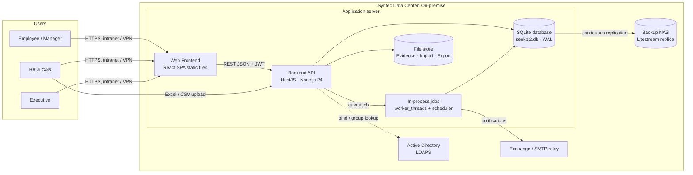

### 6.2 Layered backend (modular monolith)
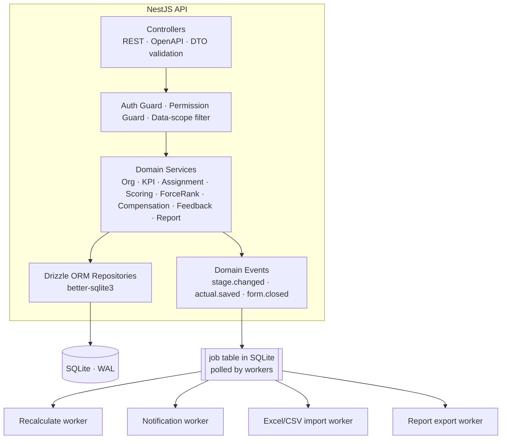

หมายเหตุ: SQLite มี Writer ได้ครั้งละ 1 Transaction ระบบจึงรัน API เป็น **Process เดียว** (ไม่ใช้ Node cluster หรือหลาย Server เขียนพร้อมกัน) และใช้ `worker_threads` สำหรับงานหนัก เช่น Export รายงาน ซึ่งอ่านอย่างเดียวผ่าน Connection แยก

## 7. Tech Stack (Production)

| Layer | Technology | เหตุผล |
|---|---|---|
| Frontend | React 19 + TypeScript 5, Vite | ต่อยอดจาก Prototype และ SEEKPI เดิมที่เป็น React อยู่แล้ว ทีมจึงเรียนรู้ได้เร็ว |
| UI Kit | MUI v7 + MUI X Data Grid Pro | Data grid รองรับ Grouping, Export และ Virtualization สำหรับรายงานขนาดใหญ่ |
| State / Data | TanStack Query v5, Zustand | จัดการ Cache, Optimistic update และ Server state |
| Forms | React Hook Form + Zod | Validation schema เดียวกันใช้ร่วมกับ Backend ได้ |
| Charts | Apache ECharts (หรือ Recharts) | Dashboard, Bell curve และ Trend |
| i18n | i18next (th / en) | นำ Dictionary 538 คีย์จากระบบเดิมมาใช้ต่อ |
| Backend | Node.js 24 LTS + NestJS 11 (TypeScript) | Modular architecture, DI, Guards สำหรับ RBAC และ OpenAPI ในตัว |
| Database | **SQLite 3.45+** (WAL mode) ไฟล์เดียวบน Local SSD | ไม่ต้องดูแล Database server แยก, Backup ง่าย, เร็วมากสำหรับ Single server และรองรับ 5,000 พนักงานได้สบาย |
| DB driver / ORM | better-sqlite3 11 + Drizzle ORM (Drizzle Kit migrations) | Synchronous driver ที่เร็วที่สุดสำหรับ SQLite, Drizzle เป็น SQL-first จึงใช้ `database/schema.sql` เป็น Baseline ได้ตรง ๆ |
| Backup / DR | Litestream (replicate WAL ไป NAS ทุก 1 วินาที) + `VACUUM INTO` snapshot รายวัน | RPO ≤ 1 นาที, Restore เป็นไฟล์เดียว |
| Auth | Active Directory ผ่าน LDAPS (ldapts) + JWT access 15 นาที / refresh token (httpOnly cookie) | ใช้บัญชีบริษัทเดิมโดยไม่พึ่ง Cloud และตรงกับเมนู LDAP ของระบบเดิม |
| Background jobs | ตาราง `job` ใน SQLite + `worker_threads` + node-cron | ไม่ต้องใช้ Redis: Recalculate, Import, Notification และ Export |
| File storage | Local file store บน Server (`/data/seekpi2/files`) รวมอยู่ใน Backup | เก็บ Evidence, ไฟล์ Import และ Export |
| Reporting | ExcelJS (xlsx), Playwright PDF rendering | Export รายงานตาม Template ของ HR |
| API docs | OpenAPI 3.1 (Swagger UI) | ใช้เป็น Contract ระหว่าง Frontend และ Backend |
| Testing | Vitest, React Testing Library, node:test / Supertest, Playwright E2E | ทดสอบทั้ง Unit, API และ E2E (รวม Scoring test) |
| Observability | pino (JSON log) → Grafana Loki, Prometheus + node_exporter, Grafana (on-prem) | ติดตาม Log, Metrics และ Alert ภายในบริษัท |
| Runtime / Deploy | Ubuntu Server 24.04 LTS (หรือ Windows Server 2022), Nginx reverse proxy + TLS, systemd service (หรือ Docker Compose) | Server เดียวพร้อม Standby, ไม่ต้องใช้ Kubernetes |
| CI/CD | GitLab CE / Azure DevOps Server (on-prem) หรือ GitHub Actions + Self-hosted runner | Lint → Test → Build → Scan (Trivy) → Deploy ด้วย Script |
| Security tooling | Renovate, Trivy, OWASP ZAP baseline, Secret ใน `.env` สิทธิ์ 600 หรือ HashiCorp Vault (on-prem) | ครอบคลุม Supply chain และการจัดการ Secret |

### 7.0 ข้อจำกัดของ SQLite และแนวทางรองรับ
| ข้อจำกัด | แนวทาง |
|---|---|
| เขียนได้ครั้งละ 1 Transaction | WAL mode, `busy_timeout = 5000`, Transaction สั้น และงาน Bulk (Recalculate ทั้ง Form) แบ่ง Batch ละ 200 Assignment |
| ขยายเป็นหลาย Application server ไม่ได้ | รัน 1 Process บน Server ที่ Spec พอ (8 vCPU / 16 GB RAM / SSD) และมี Standby server สำหรับ DR |
| ไม่มี Network access จากเครื่องอื่น | เครื่องมือ Report/BI ภายนอกอ่านผ่าน Read-only API หรือ Snapshot ไฟล์รายวัน ไม่เปิดไฟล์ฐานข้อมูลตัวจริงพร้อมกัน |
| ไม่มี Partition / Row-level security | Archive `audit_log` เป็นไฟล์รายปี และบังคับ Data scope ใน Service layer |
| ทางขยายในอนาคต | Schema เขียนด้วย SQL มาตรฐาน ถ้าภายหลังต้องการหลาย Server สามารถย้ายไป PostgreSQL ได้โดยแก้ชนิดข้อมูลเล็กน้อย |

### 7.1 Environments
| Env | วัตถุประสงค์ | ข้อมูล |
|---|---|---|
| DEV | พัฒนา | Seed / ข้อมูลสมมุติ |
| SIT/UAT | ทดสอบร่วมกับ HR | ข้อมูลที่ Mask แล้ว (ชื่อ, เงินเดือน) |
| PROD | ใช้งานจริง | ข้อมูลจริง เข้าถึงได้เฉพาะ Production support ตามสิทธิ์ |

### 7.2 Deployment (On-premise)
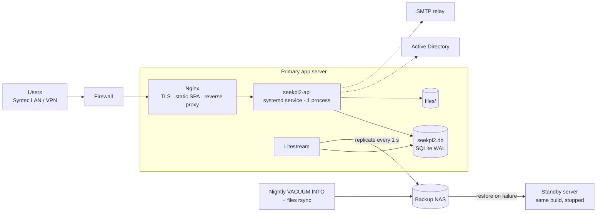

| รายการ | ข้อกำหนดแนะนำ |
|---|---|
| Primary server | VM 8 vCPU, 16 GB RAM, SSD 200 GB, Ubuntu 24.04 LTS หรือ Windows Server 2022 |
| Standby server | Spec เดียวกัน อยู่คนละ Host หรือคนละห้อง Server |
| Backup | Litestream ส่ง WAL ไป NAS ต่อเนื่อง, Snapshot รายวันเก็บ 35 วัน, Snapshot รายเดือนเก็บ 12 เดือน และทดสอบ Restore ทุกไตรมาส |
| Maintenance | `PRAGMA optimize` ทุกคืน, `VACUUM` รายเดือน (นอกเวลาทำการ) และ Archive `audit_log` รายปี |

## 8. Database Design

### 8.1 หลักการออกแบบ
- ใช้ **SQLite 3.45+** เป็นไฟล์เดียว `seekpi2.db` ในโหมด WAL (DDL อยู่ที่ `database/schema.sql` และตรวจแล้วว่าสร้างได้บน SQLite 3.53)
- ทุก Connection ต้องตั้ง `PRAGMA foreign_keys = ON`, `busy_timeout = 5000` และ `synchronous = NORMAL` (SQLite ไม่จำค่าเหล่านี้ไว้ในไฟล์)
- ประกอบด้วย 58 ตาราง (แบ่ง 9 Domain), View สำหรับรายงาน 2 ตัว, Foreign key 116 ตัว และ Trigger 23 ตัว
- เป้าหมายและผลจริงรายงวดอยู่ใน `assignment_item_period` (L1–L5, actual, score) สถานะและคะแนนต่อ Structure อยู่ใน `assignment_structure` และลำดับผู้ประเมิน (ACTION TO) อยู่ใน `assessor_chain`
- ชนิดข้อมูล: วันที่และเวลาเก็บเป็น TEXT แบบ ISO-8601 (UTC), Boolean เป็น INTEGER 0/1, JSON เป็น TEXT ที่ตรวจด้วย `json_valid()` และ Enum เป็น TEXT + CHECK
- `audit_log` และ `assignment_stage_log` เป็น Append-only (Trigger ห้าม UPDATE/DELETE) และ Archive `audit_log` เป็นไฟล์ `seekpi-audit-YYYY.db` รายปี
- ตาราง `job` ทำหน้าที่เป็น Queue ของงานเบื้องหลังแทน Redis
- ทุกตาราง Master มี `company_id` เพื่อรองรับหลายบริษัท (Syntec, บริษัทในเครือ และ Joint Venture)
- ข้อมูลมีผลตามช่วงเวลา (`effective_from` / `effective_to`) สำหรับ Organization, Position และ Employee job history
- ข้อมูลธุรกรรม (Assignment, Stage log, Audit) ไม่ลบจริง ส่วน Master data ใช้ `is_active`
- ปรับเกณฑ์ JSON ใน Prototype ให้เป็นตารางปกติ ได้แก่ `threshold_band`, `grade_band`, `force_rank_quota` และ `criteria_structure_weight`
- ใช้ Constraint บังคับ Business rule ในระดับฐานข้อมูล ได้แก่ unique assignment ต่อคนต่อ Form, น้ำหนักรวม 100% ก่อนออกจาก Draft, check ช่วงคะแนน และ generated column `new_salary` / `final_bonus`

### 8.2 Domain overview
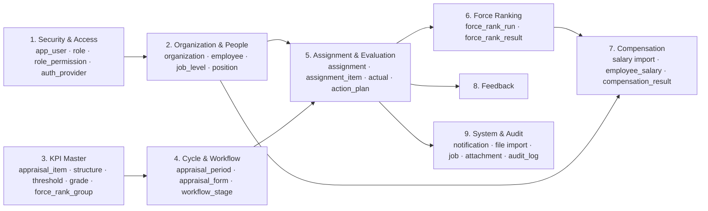

### 8.3 ERD: Security & Organization
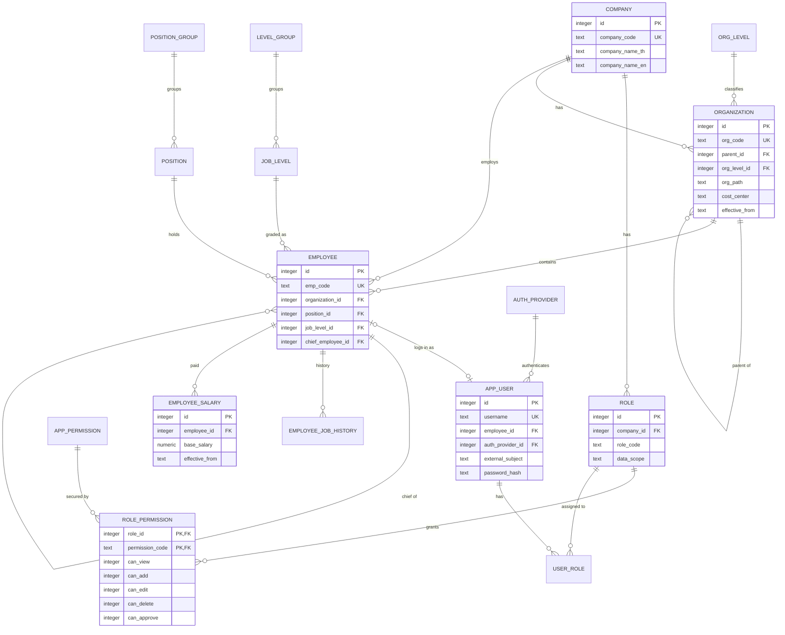

### 8.4 ERD: KPI master & cycle configuration
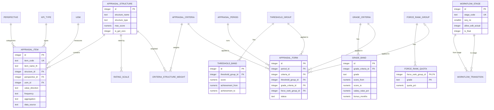

### 8.5 ERD: Assignment, evaluation, calibration & compensation
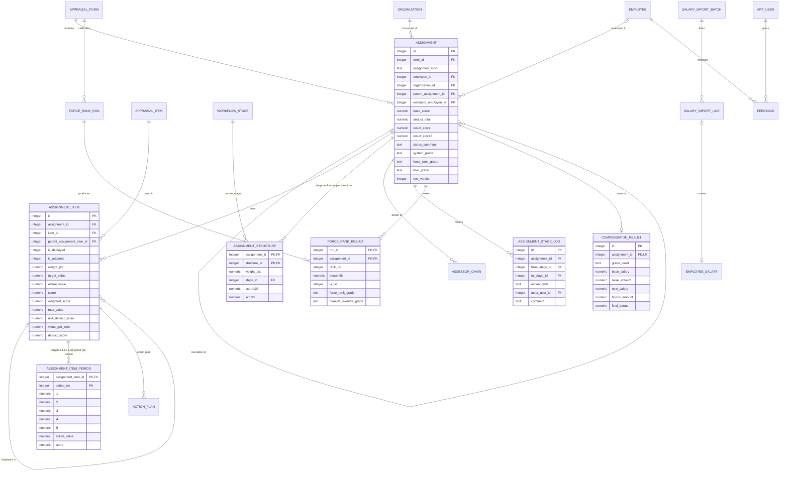

### 8.6 Data dictionary (ตารางหลัก)
| ตาราง | คำอธิบาย | ปริมาณโดยประมาณ / ปี |
|---|---|---|
| `employee` | ข้อมูลพนักงานปัจจุบัน (Snapshot), ประวัติอยู่ใน `employee_job_history` | 5,000 |
| `appraisal_item` | Dictionary ของ KPI และ Competency | 500 |
| `appraisal_form` | รอบการประเมิน (เช่น Annual 2026, Mid-year 2026) | 2–4 |
| `assignment` | Scorecard: 1 แถวต่อพนักงานหรือหน่วยงานต่อ Form | 10,000 |
| `assignment_item` | KPI line ใน Scorecard | 150,000 |
| `assignment_item_period` | เป้า L1–L5 และผลจริงรายงวด (Monthly 12 / Quarterly 4 / Yearly 1) | 1,000,000 |
| `assignment_structure` | สถานะ Workflow และคะแนนต่อ Structure | 30,000 |
| `assignment_stage_log` | ประวัติ Workflow | 60,000 |
| `force_rank_result` | ผลการ Calibrate ต่อ Run | 10,000 ต่อ Run |
| `compensation_result` | Merit และ Bonus | 5,000 |
| `audit_log` | Usage / Audit log (Archive เป็นไฟล์รายปี) | 2–5 ล้าน |
| `job` | Queue งานเบื้องหลัง (ลบงานที่เสร็จแล้วเก่ากว่า 30 วัน) | หมุนเวียน |

### 8.7 Index, Performance และ Backup
- Partial unique index `ux_assignment_individual (form_id, employee_id)` ป้องกันการมอบหมายซ้ำ
- `ix_org_path` (materialized path) สำหรับ Query ทั้ง Subtree ขององค์กร เช่น Dashboard ระดับ Division
- รายงานขนาดใหญ่ใช้ View `v_assignment_summary` และ `v_kpi_trend` และเมื่อข้อมูลโตให้สร้างตารางสรุป (Summary table) ที่ Refresh ตอน Recalculate
- Backup: Litestream replicate WAL ไป NAS ต่อเนื่อง, `VACUUM INTO` snapshot รายวันเก็บ 35 วัน และทดสอบ Restore ทุกไตรมาส ห้าม Copy ไฟล์ `.db` ตรง ๆ ขณะระบบทำงาน
- ข้อมูลเงินเดือน (`employee_salary`, `compensation_result`) SQLite ไม่มี DB role จึงบังคับสิทธิ์ที่ API (`report_bonus_salary` / `import_salary`) และเข้ารหัส Disk ของ Server

## 9. Workflow Diagrams

### 9.1 Annual performance cycle
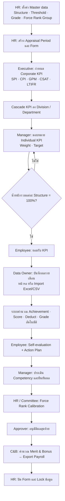

### 9.2 Workflow ต่อ Structure (ตามระบบเดิม)
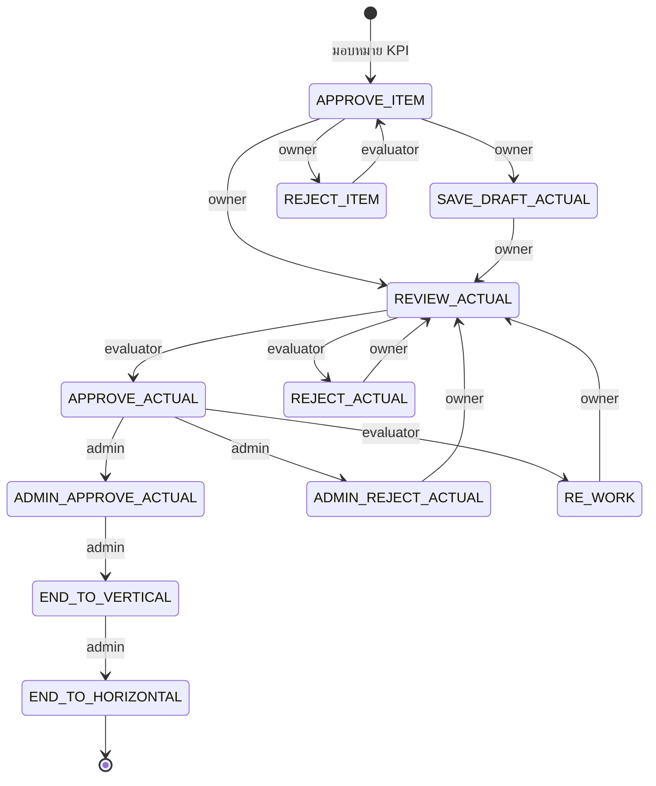

Competency มี Workflow แยก: Appraisal → Save Draft / Submit (ผู้ประเมิน) → Approve / Reject (admin) → End to Vertical / End to Horizontal และรายละเอียด Transition ทั้งหมดอยู่ที่ `server/workflow.js`

### 9.3 Data entry & scoring sequence
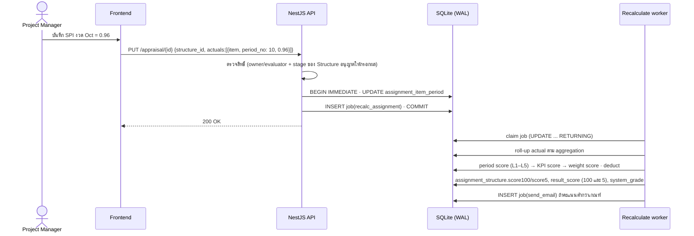

### 9.4 Force rank calibration
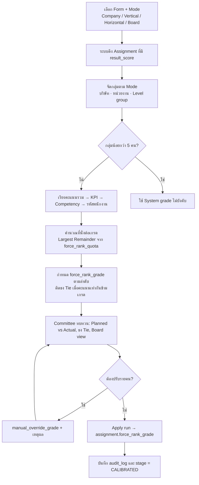

### 9.5 Login ด้วย Active Directory
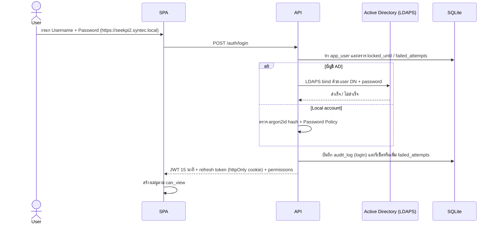

### 9.6 Salary import & compensation
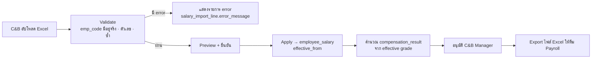

## 10. API Design (REST, `/api/v1`)

| Resource | Endpoints หลัก |
|---|---|
| Auth | `POST /auth/login`, `POST /auth/refresh`, `POST /auth/logout`, `GET /me` |
| Data import | `POST /imports/{employees,organizations,actuals}` (Upload → Validate), `POST /imports/{id}/apply`, `GET /imports/{id}` |
| Master data | `GET/POST /{resource}`, `GET/PATCH/DELETE /{resource}/{id}` สำหรับ company, organizations, levels, positions, perspectives, items และอื่น ๆ |
| Roles | `GET/PUT /roles/{id}/permissions` |
| Forms | `POST /forms`, `POST /forms/{id}/open`, `POST /forms/{id}/close` |
| Assignments | `GET /assignments?formId&kind&orgId&stage`, `POST /assignments:bulk`, `PATCH /assignments/{id}`, `POST /assignments/{id}/transitions/{action}` |
| Actuals | `PUT /assignment-items/{id}/actuals/{yyyy-mm}`, `POST /actuals:import` |
| Force rank | `POST /force-rank-runs`, `GET /force-rank-runs/{id}`, `PATCH /force-rank-runs/{id}/results/{assignmentId}`, `POST /force-rank-runs/{id}/apply` |
| Compensation | `POST /salary-imports`, `POST /salary-imports/{id}/apply`, `POST /compensation/{formId}/calculate`, `POST /compensation/{formId}/approve` |
| Dashboards | `GET /dashboards/overall`, `/branch`, `/comparison`, `/trend` |
| Reports | `GET /reports/{code}?formId&orgId`, `POST /reports/{code}/export` (สร้าง Job แล้วดาวน์โหลดไฟล์จาก File store) |
| Feedback | `GET/POST /feedback`, `GET /feedback/report` |
| Audit | `GET /audit-logs` |

มาตรฐานของทุก Endpoint: pagination แบบ `?page&pageSize` (สูงสุด 200), error format ตาม RFC 9457 (Problem Details), ส่ง `If-Match` / `row_version` สำหรับ update และ Rate limit 300 req/นาที/ผู้ใช้

## 11. Migration จาก SEEKPI เดิม

| ขั้น | งาน |
|---|---|
| 1 | Export Master data จากระบบเดิม (Company, Org, Level, Position, Item, Criteria) ผ่าน API เดิมหรือ DB dump ซึ่งต้องได้รับอนุญาตจากเจ้าของระบบ |
| 2 | Mapping: `level` เดิมแยกเป็น `org_level` + `job_level`, JSON/เกณฑ์เดิมแปลงเป็น `threshold_band` / `grade_band` |
| 3 | นำเข้าประวัติผลประเมิน 3 ปีล่าสุดเป็น Form ที่สถานะ `closed` (read-only) เพื่อให้ Trend Dashboard ต่อเนื่อง |
| 4 | Parallel run 1 รอบ (เช่น Mid-year) เทียบผลคะแนนกับระบบเดิม ยอมรับความต่างได้ ≤ 0.01 คะแนน |
| 5 | Cut-over, Redirect URL เดิม `/seekpi` ไป `/seekpi-2` และ Freeze ระบบเดิมเป็น Read-only 1 ปี |

## 12. Delivery Roadmap

| Phase | ระยะเวลา | Deliverable |
|---|---|---|
| 0 Discovery | 2 สัปดาห์ | ยืนยันสูตรคำนวณกับ HR (หัวข้อ 11 ของ Scoring Method), เก็บหน้าจอระบบเดิมหลัง Login (REA signed-in capture), เตรียม Server on-prem, UAT plan |
| 1 Foundation | 4 สัปดาห์ | Login AD/Local, RBAC, Master data, Import พนักงานและองค์กรจาก Excel, Backup (Litestream) |
| 2 Core appraisal | 6 สัปดาห์ | Form, Assignment, Cascade, Data entry, Scoring, Workflow |
| 3 Calibration & Compensation | 4 สัปดาห์ | Force Rank 4 โหมด, Salary import, Merit/Bonus |
| 4 Insight | 3 สัปดาห์ | Dashboard 4 หน้า, รายงาน 9 ฉบับ, Export |
| 5 Hardening & Go-live | 3 สัปดาห์ | Performance test, Security test (ZAP / Pentest), Data migration, Training |

## 13. ข้อสมมุติและประเด็นที่ต้องยืนยัน
1. สูตร Deduct (BR-06) ยืนยันได้จากโค้ดหน้าจอของ SEEKPI เดิม ส่วนการปัดเศษ Force Rank, ความหมายของ Value Get Zero และตัวตัดสินเมื่อคะแนนเท่ากัน ต้องให้ HR ยืนยันตามหัวข้อ 11 ของ `SEEKPI-2_Scoring_Method.md`
2. ศึกษาหน้าจอระบบเดิมหลัง Login แบบอ่านอย่างเดียวแล้ว (`rea-analysis/SEEKPI_Original_Feature_Catalogue.md`) เหลือ 7 เมนูที่บัญชีที่ใช้ศึกษาไม่มีสิทธิ์ (Force Rank Company, Branch Performance, Data Entry Status, Setting ทั้ง 4 และ Adjust) และเนื้อหารายงานที่สร้างที่ Server ซึ่งต้องทวนใน Phase 0
3. **ตัดสินแล้ว:** ติดตั้ง On-premise, ใช้ SQLite และไม่เชื่อมต่อ D365 (ข้อมูลพนักงานและผล KPI นำเข้าด้วย Excel/CSV)
4. ต้องเตรียม Server 2 เครื่อง (Primary + Standby), NAS สำหรับ Backup, บัญชี Service สำหรับ LDAPS และ SMTP relay จากทีม IT Infrastructure
